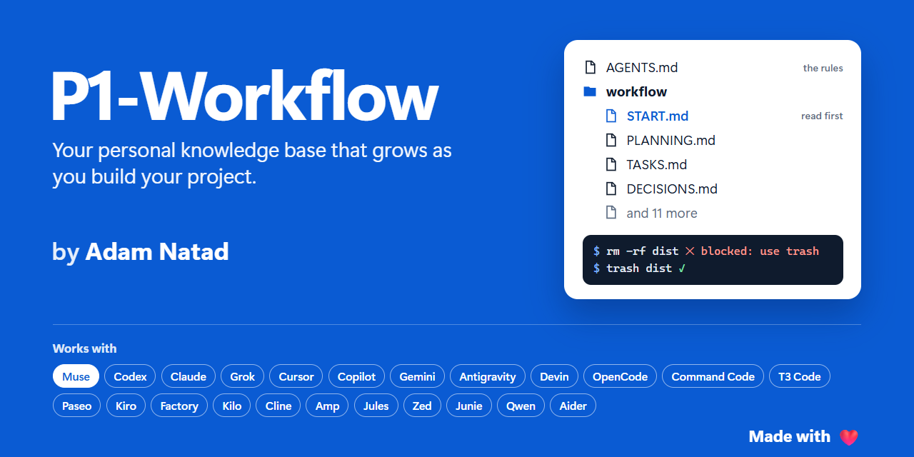

# P1-Workflow by [Adam Natad](https://papeliz.com/adam-natad/)

**Your personal knowledge base that grows as you build your project.**

---

A free project template for building any software project with AI coding agents.

One folder of plain Markdown, `workflow/`, holds everything that decides what gets built: the
product, the plan, the tasks, the decisions and the history. Every agent reads it before it touches
code and writes back what it did, so the next session, and the next agent, starts from the truth
instead of a guess.

It works with Muse Code, Codex, Claude Code, Grok Build, Cursor, GitHub Copilot, Gemini CLI and 16
more. It is all plain Markdown: open it in any editor, or as a vault in
[Papeliz](https://papeliz.com/templates/p1-workflow/).

## Contents

- [Why P1-Workflow](#why-p1-workflow)
- [What's inside](#whats-inside)
- [Start a project with it](#start-a-project-with-it)
- [How a session goes](#how-a-session-goes)
- [The 15 workflow files](#the-15-workflow-files)
- [Several agents at once](#several-agents-at-once)
- [Works with every coding agent](#works-with-every-coding-agent)
- [Safe by default](#safe-by-default)
- [Make it yours](#make-it-yours)
- [Questions](#questions)

## Why P1-Workflow

- **Agents forget; files don't.** Every session starts by reading the same files and ends by
  writing back what it did, so nothing depends on one chat's memory.
- **One source of truth.** Fifteen files decide what gets built. Notes explain, records support,
  and proposals wait for your decision, but only those fifteen files authorize work.
- **Phase by phase.** Agents work the current phase only, mark tasks done the moment they're done,
  and add what they find, so the task list is always true.
- **You set the schedule.** Plans carry phases, scope and order, never dates or durations.
- **Safe by default.** Deletes go to the Recycle Bin or Trash, pictures carry no hidden data,
  secrets stay out of files, and commits carry no AI attribution.
- **Many agents, one rulebook.** Use one agent or several at once; they all follow `AGENTS.md`.

## What's inside

| Path | What it is |
| --- | --- |
| `AGENTS.md` | The rules every coding agent follows. Muse Code, Codex, Grok Build, Cursor, Copilot and most others read it on their own |
| `CLAUDE.md` | Points Claude Code at `AGENTS.md`, plus what only Claude Code needs |
| `session-start-command.md` | The line you paste at the start of every agent session |
| `workflow/` | The 15 files that authorize work, from `START.md` to `HISTORY.md` |
| `workflow/notes/` | The knowledge base: how things work (`docs/`), how to do an operation (`runbooks/`), one note per code module (`areas/`), and templates for every kind of note |
| `workflow/tasks/` | Records for the current milestone, and proposals waiting for a decision (`pending/`) |
| `workflow/archive/` | The read-only past |
| `test_trash/` | Disposable scratch, with `mockups/`, `artifacts/` and `logs/` ready. Git keeps only its README and those empty folders |
| `tools/strip-picture-hidden-data.mjs` | Strips C2PA, EXIF, XMP, IPTC and other hidden data from PNG, JPEG, WebP and SVG pictures, checks them, and installs a Git pre-commit hook that strips every staged picture |
| `.agents/hooks/block-permanent-delete-commands.mjs` | The delete guard every agent's hook runs before a shell command: no `rm`, `del` or `Remove-Item`, only `trash` |
| Agent settings | `.muse/`, `.codex/`, `.claude/`, `.grok/`, `.cursor/`, `.github/hooks/`, `.agents/hooks.json`, `.gemini/`, `.qwen/`, `.devin/`, `.factory/`, `.kiro/`, `.commandcode/`, `opencode.json`, `.kilo/` and `.aider.conf.yml`: each agent's hook or deny list, and where needed, a pointer to `AGENTS.md` |
| `.gitignore`, `.gitattributes` | What Git ignores, and line endings that work on every operating system |

## Start a project with it

1. Put these files at the root of your project's repository.
2. Replace "[project name]" and its one-line description in `AGENTS.md`, `CLAUDE.md` and
   `workflow/START.md`, and `PROJECT` in the task IDs in `workflow/TASKS.md`.
3. Install [Node.js](https://nodejs.org) and [`trash`](https://github.com/sindresorhus/trash-cli),
   then turn on the picture check for every commit:
   `node tools/strip-picture-hidden-data.mjs --install-git-hook`.
4. Start an agent session with the line in `session-start-command.md`, and tell it what you want to
   build. Trust the project folder when your agent asks, so its hooks run.
5. Milestone 0.1, Planning and design, is already in `workflow/TASKS.md`:
   - the agent writes the product plan, the roadmap and a proposed stack, and makes design options;
   - you approve the product and the stack, and pick a design and a license.

   Then the first real milestone starts.

## How a session goes

1. The agent reads `AGENTS.md` and `workflow/START.md`, then the files in the order `START.md`
   gives.
2. It takes the first open task of the current phase in `workflow/TASKS.md`, and only that phase.
3. It builds, then runs the build, lint and tests that `workflow/ACCEPTANCE.md` asks for.
4. It marks the task done, adds any task it found, and records the session:
   - what it did in `workflow/CHANGELOG_AI.md`, every session;
   - a decision and why in `workflow/DECISIONS.md`;
   - an architecture change in `workflow/HISTORY.md`;
   - anything broken in `workflow/BUGS.md`.
5. It ends with the ten-item session summary in `AGENTS.md`.

## The 15 workflow files

| File | What it holds |
| --- | --- |
| `START.md` | Where the project stands, and what to read in which order |
| `PLANNING.md` | The roadmap: milestones and their phases, in order, with no dates |
| `TASKS.md` | Open work, top first, grouped by milestone and phase |
| `PRODUCT.md` | What the project is, who it's for, and what it is not |
| `ACCEPTANCE.md` | What "done" means for every task, phase and milestone |
| `TECH_STACK.md` | The approved tools, libraries and services, with exact versions |
| `FOLDER_STRUCTURE.md` | Where everything goes; a new path is added here first |
| `DATABASE.md` | Every place the project stores data, and how it changes |
| `ENVIRONMENT.md` | What a computer needs, and every setting's name (never a secret's value) |
| `DEPLOYMENT.md` | Where it runs, how a release gets there, and every deploy |
| `LAUNCHER.md` | One command to start, build, test and lint on each operating system |
| `DECISIONS.md` | Ledger: why, with the owner's own words |
| `BUGS.md` | Ledger: what is broken right now |
| `CHANGELOG_AI.md` | Ledger: what each agent session did |
| `HISTORY.md` | Ledger: how the architecture changed, and when |

## Several agents at once

One **coordinator** session owns the ledgers, the shared checks and every commit. Each parallel
**lane** session gets a packet (`workflow/notes/templates/lane-packet.md`) that names the files it
may edit and what done looks like. Lanes never commit and never touch each other's files; the
coordinator rechecks each lane's work before it commits it. The whole round is in
`workflow/notes/runbooks/parallel-lanes.md`.

## Works with every coding agent

All of them follow the same `AGENTS.md`.

- **Read it on their own:** Muse Code, Codex, Grok Build, Cursor, GitHub Copilot, Antigravity,
  Devin (formerly Windsurf), Factory Droid, Kiro, Command Code, OpenCode, Kilo Code, Cline, Amp,
  Jules, Zed and JetBrains Junie.
- **Read it through a small file or setting:** Claude Code (`CLAUDE.md`), Gemini CLI and Qwen Code
  (their settings), and Aider (`.aider.conf.yml`).
- **Run the agents above:** T3 Code and Paseo, so the same files and hooks apply through the agent
  each one runs.

**The delete guard.** Every agent that supports hooks runs the same guard before a shell command:
Muse Code, Codex, Claude Code, Grok Build, Cursor, Copilot, Antigravity, Gemini CLI, Qwen Code,
Devin, Factory Droid, Kiro and Command Code. It refuses a permanent delete, so every deletion goes to the Recycle
Bin or Trash through `trash`. OpenCode and Kilo Code get deny rules instead.

The table of agents, their files and how each one blocks is in
`workflow/notes/docs/coding-agents-and-the-delete-guard.md`.

**Recommended or All.** When you create a project from this template, Recommended leaves out every
agent's settings folder: your agents still follow `AGENTS.md`, but the delete-guard hooks come only
with All. If you took Recommended, copy your agent's folder from this repository to add its hook.

## Safe by default

- **Deletes are recoverable.** Every deletion goes through `trash`, and every agent's hook enforces
  it.
- **Pictures carry no hidden data.** `tools/strip-picture-hidden-data.mjs` strips C2PA, EXIF, XMP
  and the rest, and its Git pre-commit hook does it on every commit.
- **No secrets in files.** Keys and passwords live in environment variables or a secrets manager;
  `ENVIRONMENT.md` names each one without its value.
- **No AI attribution.** Commits, pull requests and release notes are made as you, with no agent
  trailer or footer.
- **Careful Git.** Stage exact paths, never `git add -A`; never force-push; commit and push only when
  you ask.
- **Specific names only.** `invoiceLineTotalCents`, never `total`.

## Make it yours

- Keep the 15 file names in `workflow/`: agents and people find them by name.
- The rules in `AGENTS.md` are good defaults. Change any that don't fit, and record why in
  `workflow/DECISIONS.md`.
- Add what you learn about how you like to work under "Learned owner preferences" in `AGENTS.md`.

## Questions

**Does it need a particular editor or agent?** No. It is plain Markdown, and every agent above
follows it.

**What does it need installed?** Git, [Node.js](https://nodejs.org) for the delete guard and the
picture tool, and [`trash`](https://github.com/sindresorhus/trash-cli).

**Can a hook be turned off?** It can, but `AGENTS.md` says never to. Change the guard in one place,
`.agents/hooks/block-permanent-delete-commands.mjs`, test it with `--check`, and record why in
`workflow/DECISIONS.md`.

---

Made with ❤️ by [Adam Natad](https://papeliz.com/adam-natad/)

© 2026 [Natad Corporation](https://natad.ai/) · [MIT License](LICENSE)
